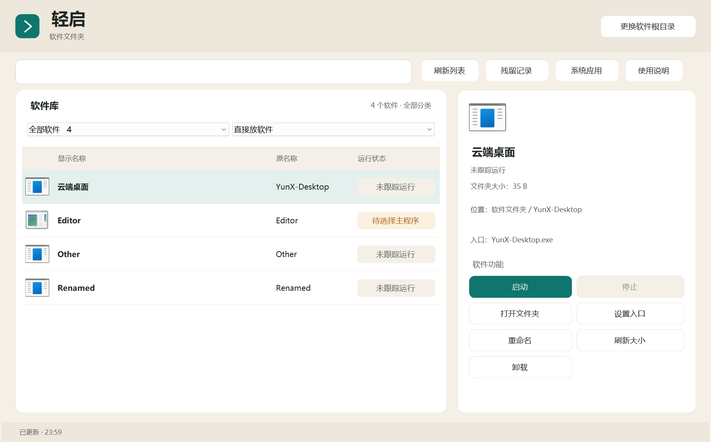

# 轻启 LightLaunch

Windows 11 轻量软件启动管理器。把便携软件、自制工具和单 EXE 放进统一目录，查看图标、启动、停止与卸载。

**当前版本：0.1.11，支持 Windows 11 x64。** 使用 .NET 8 Windows Forms，原创代码采用 MIT 许可证。



## 下载

前往 [Releases](https://github.com/yan450863-ui/LightLaunch/releases/latest)：

- 首次使用：下载 `LightLaunch-0.1.11-win-x64.zip`，自带运行库。完整解压后双击 `启动.cmd`。
- 已有 0.1.10：下载 `LightLaunch-0.1.11-update.zip`，完整解压后双击 `更新.cmd`，选择老版轻启主文件夹。只更新轻启自身程序，保留用户软件和配置，无需搬家。运行库不兼容时保留原版并提示使用完整包。
- 自行编译：下载 `LightLaunch-0.1.11-source.zip` 或克隆仓库。

程序默认请求管理员权限，需要在 Windows UAC 中确认；启动的工具会继承该权限。当前版本未签名。

## 放入软件

完整包自带“软件文件夹”，首次启动默认读取它：

```text
轻启/
├─ 启动.cmd
├─ 程序/                 轻启自身文件
├─ 软件文件夹/           放用户的软件
│  ├─ 我的编辑器/         完整保留软件目录
│  │  ├─ editor.exe
│  │  └─ resources/
│  └─ 独立工具.exe        单 EXE 可直接放入
└─ 数据/                 首次运行后生成
```

每个直接子文件夹或单 EXE 对应一款软件，内部的 app、data、runtime 不会被拆成其他软件。搬入后自动出现，移出后从列表移除，新软件不会自动运行。

列表上方可切换“直接放软件”或“按分类放软件”；后者支持“根目录 / 分类 / 软件”，保留旧版目录结构。旧配置继续使用原模式；如果旧版曾把软件拆成子目录，更新后切换为“直接放软件”即可，无需移动软件。也可更换根目录。

## 功能

- 左侧列表显示图标、中文别名、单独一列的原名称和运行状态，中英文均可搜索；右侧提供所选软件的功能区及大小信息。
- 自动推荐顶层唯一普通程序；多个主程序时选择并记住，也可浏览指定软件目录内的 exe / cmd / bat。单 EXE 使用自身作为入口。
- 图标读取主程序资源，没有可用图标时使用默认图标。重命名只修改显示名称，不改实际文件或文件夹，不影响卸载识别使用的原信息。
- 优先跟踪管理器启动的进程组；停止先请求正常退出，强制结束前确认。重启管理器不会接管原有进程。
- 便携文件夹移入回收站；单 EXE 只回收自身，同目录其他内容保留；安装版匹配并调用正规卸载程序。
- 安装版卸载后保存残留记录，选择或搜索后自动重新检测。可查看、勾选并确认清理；文件移入回收站，注册表先按原视图备份。

完整软件的大小仅统计其文件夹；单 EXE 仅统计自身。配置和清理备份在 `数据/`，程序升级备份在 `数据/升级备份/`。详见内置“使用说明”或 [使用说明](资料/使用说明.md)。

## 使用边界

优先支持便携软件和自制小工具。部分完整剪切的安装版能关联原卸载记录，卸载期间临时提供原路径；服务、驱动、更新器或写死旧路径的软件可能无法迁移，管理员权限不能修复这些依赖。

残留检测范围有限，不表示全系统无残留；候选可能含个人或共享数据。卸载未确认完成、位置变化、链接、公共目录或备份失败等情况会保留相关项。单 EXE 不按整个软件库执行卸载或残留清理。

本版不含自动更新、软件商店、云同步、缓存清理或自动搬迁。升级包是手动执行的离线更新工具。

## 构建与检查

需要 Windows 和 .NET 8 或更新 SDK，在仓库根目录运行：

```powershell
dotnet build ./源码/LightLaunch/LightLaunch.csproj -c Release
dotnet run --project ./测试/残留检测验证/ResidueChecks.csproj -c Release
dotnet run --project ./测试/目录入口验证/DirectoryChecks.csproj -c Release
```

生成发布包还需要 Git，从克隆的仓库提交修改后运行：

```powershell
powershell -NoProfile -ExecutionPolicy Bypass -File ./源码/打包发布.ps1
dotnet run --project ./测试/发布包验证/PackageChecks.csproj -c Release -- ./发布/0.1.11/LightLaunch-0.1.11-win-x64
```

产物在 `发布/0.1.11/`，包含完整包、升级包、源码包及 SHA-256 校验文件。已有同版本目录时拒绝覆盖。`源码/构建.ps1` 保留依赖本机运行库的开发发布方式。

## 开源与贡献

[MIT 许可证](LICENSE) · [开源致谢](资料/开源致谢.md) · [贡献说明](CONTRIBUTING.md) · [安全问题说明](SECURITY.md)

仓库与发布包不包含个人配置、残留备份、第三方安装包或实际安装测试数据。
